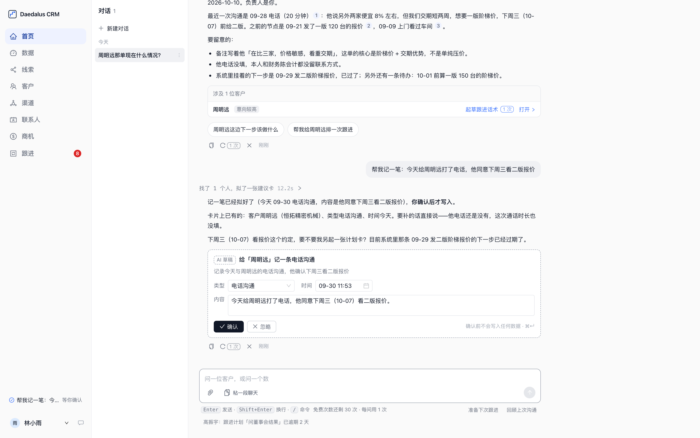
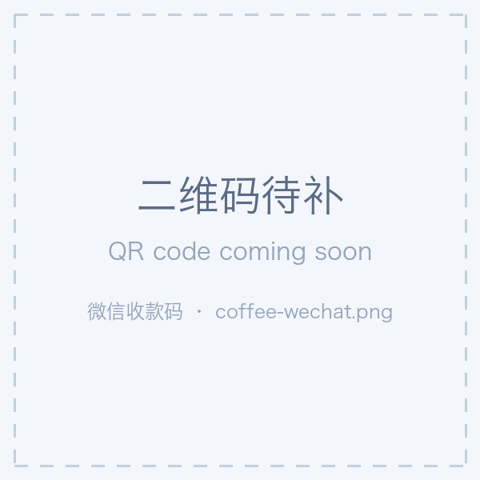
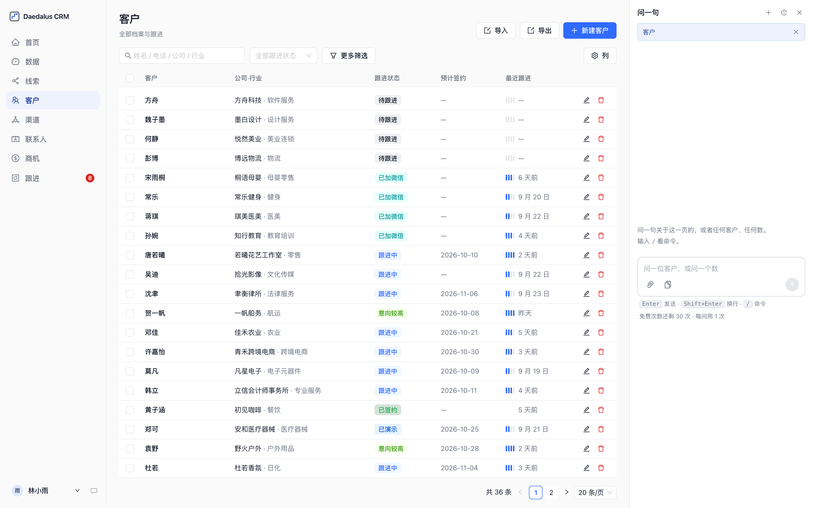
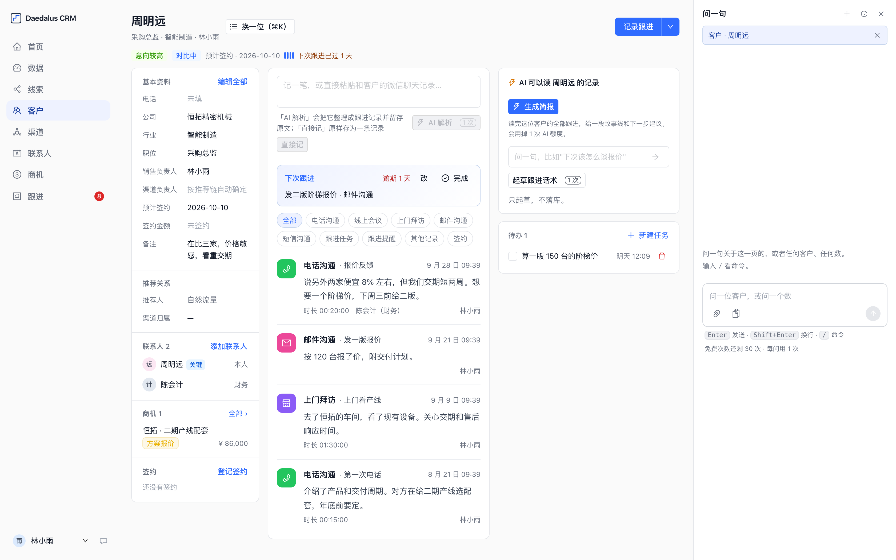
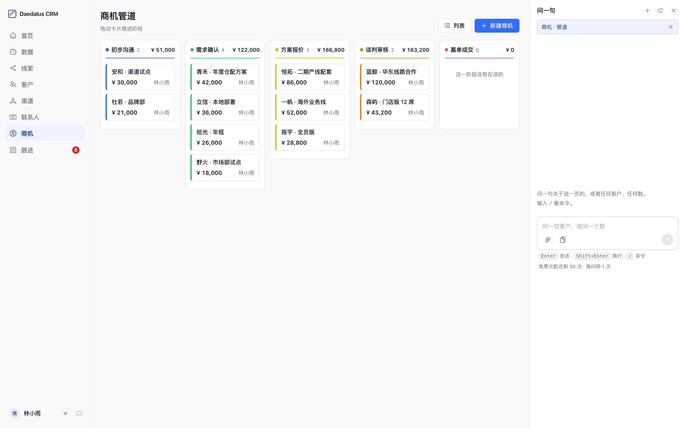
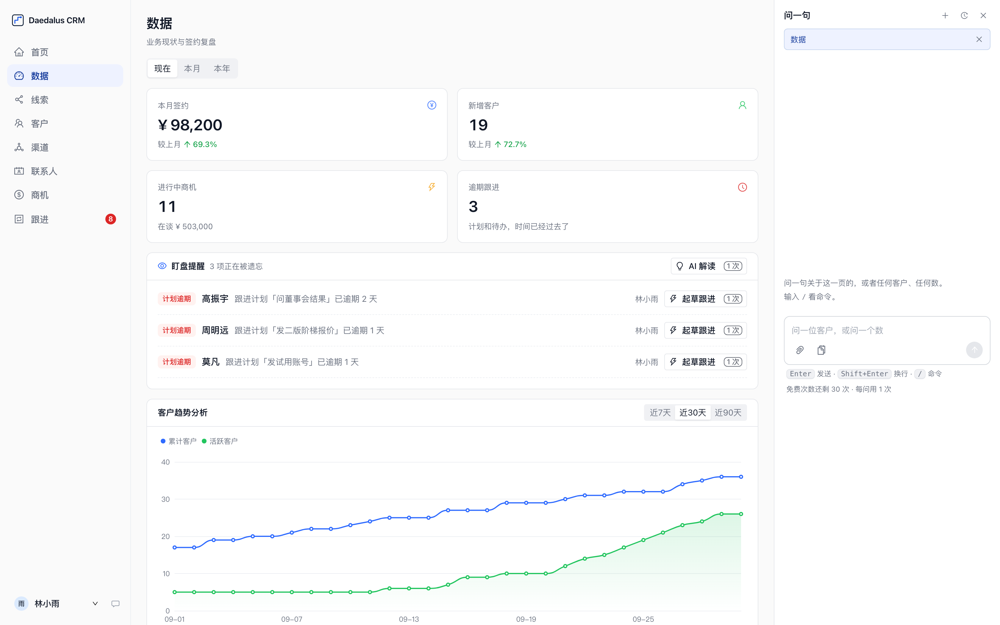

<div align="center">


# Daedalus CRM

**The next-generation CRM that runs on your own computer. AI drafts, you decide.**

**A desktop CRM for Mac and Windows**: leads → customers → follow-ups → deals → contracts, with referral attribution computed for you.<br/>
**Personal edition — free**: for solo founders, independent consultants and salespeople who own their book. Install it and go; your data is a file on your computer.<br/>
**Team edition — billed per seat**: everyone runs their own desktop app, and customers, follow-ups and deals sync automatically.<br/>
The home page is an agent: ask a question and it decides what to look up; ask it to change data and it hands you a proposal card — nothing is written until you confirm.

[](LICENSE)
[](https://github.com/BeckY824/daedalus-crm/actions/workflows/ci.yml)
[](https://github.com/BeckY824/daedalus-crm/tags)
[](https://github.com/BeckY824/daedalus-crm/pkgs/container/daedalus-crm)
[](https://github.com/BeckY824/daedalus-crm/stargazers)

[简体中文](README.md) · **English**

[Website](https://ai-daedalus.com) · [Download for Mac](https://ai-daedalus.com/en/download.html) · [Download for Windows](https://ai-daedalus.com/en/download.html) · [Roadmap](ROADMAP.md) · [Issues](https://github.com/BeckY824/daedalus-crm/issues) · [☕ Buy us a coffee](#-buy-us-a-coffee)

</div>

<br/>

## Personal and Team editions

Desktop only: Mac (Apple silicon) and Windows (x64), both from the [download page](https://ai-daedalus.com/en/download.html).

| | Who | How it works | Price |
|---|---|---|---|
| 🖥 **Personal** | **One person.** A salesperson, a freelancer, a one-person company | Sign up for a free account with your email right inside the app, and you're in. Data stays on your computer and works offline | Free |
| 👥 **Team** | **A few people working the same customers** | Everyone runs their own desktop app; customers, follow-ups and deals sync automatically. See [Setting up a team](#setting-up-a-team) | Per seat, with a 14-day free period after activation |

Team data also lives on each person's own computer: changes are encrypted and relayed through our server, the key exists only in the team invite code, and we can't read the content.

Stable versions: [latest Release](https://github.com/BeckY824/daedalus-crm/releases/latest). Patches: [rolling Release](https://github.com/BeckY824/daedalus-crm/releases/tag/desktop-updates).

<br/>

<div align="center">

**100% open source &nbsp;·&nbsp; Your data stays on your computer &nbsp;·&nbsp; AI only drafts — every write is a human click**

</div>

- ✅ Install and go: download, install, sign up with your email inside the app — no server to set up; data stays on your computer and works offline
- ✅ The home page is an agent: ask about a customer or a number and it decides what to search, read and query — every step visible
- ✅ Tell it "log a call", "mark as signed", "schedule next Wednesday", "create a deal" — it returns an editable proposal card; nothing lands until you confirm
- ✅ "Paste a chat" right in the home-page input box: drop in a list someone forwarded you on WeChat, AI splits it into customers, nothing is saved until you confirm, and the whole batch can be undone
- ✅ Paste a chat transcript on a record page; AI turns it into a follow-up, tasks and next steps, with the original kept
- ✅ Referral attribution: who introduced whom and whose performance it counts toward, frozen at entry — upstream edits never rewrite history
- ✅ Phone dedup, double-confirm on repeated contract amounts, field-level merge on concurrent edits, full audit trail
- ✅ Runs on DeepSeek: pick it in Settings, paste a key, done — endpoint and model name are filled in for you (any other OpenAI-compatible endpoint still works under "Other")
- ✅ AI never acts on its own: every model call is a click you make — opening a page never triggers one (free credits are counted per question; the UI shouldn't spend them for you)
- ✅ Two columns, not three: navigation on the left is always there, content on the right. Only the customer record page adds a narrow list — for when you flip through people one after another
- ✅ Keyboard-first where it matters: ⌘K to jump or ask, ⌘, for settings, ⌘1–9 for modules
- ✅ Generic sales wording out of the box (customer / company / title / industry); education-sales wording is one preset click away

<br/>



<br/>

## 🚀 Getting started

1. Download the desktop app from the [download page](https://ai-daedalus.com/en/download.html): Mac (Apple silicon) or Windows (x64). Intel Mac builds are not available yet
2. The first launch opens the sign-in page: sign up for a free account with your email (right inside the app), then sign in
3. To use AI, pick either route — the settings page tells you which one is in use and how many questions are left:
   - **Our models**: 30 free AI questions on your first sign-in (one grant per computer, not topped up). One question costs one credit, and a question that fails on our side is refunded
   - **Your own key**: put your own model API key in **Settings → AI** (DeepSeek recommended) and keep going with no count. The key is encrypted on your computer and only ever sent to the endpoint you typed
4. **Different industry?** Settings → Business config renames the noun and the three profile fields site-wide (education admissions is a ready-made preset — one click swaps the whole set)

Mac uses delta updates; Windows updates use the full installer. The Windows installer is unsigned — see the [Windows guide](docs/Windows版.md).
Builds are produced by [GitHub Actions](https://github.com/BeckY824/daedalus-crm/actions/workflows/desktop.yml) on every tag. Install, Gatekeeper and updates: [docs/桌面端安装.md](docs/桌面端安装.md).

### Setting up a team

1. The owner creates a team under **Settings → Team**
2. Click **Feedback** at the bottom left to request activation
3. Once we activate it, teammates join with the invite code

**Billed per seat**: one seat per person on the team, including whoever created it; 14 days free after activation. For pricing, [contact us](mailto:qy1g18@gmail.com).

<br/>

## ☕ Buy us a coffee

The Personal edition stays free and the code stays open source — **whether or not you chip in.**
If it saves you time, a coffee is about $3. For now we can only take WeChat Pay and Alipay:

<table>
  <tr>
    <td align="center"><br/><sub>WeChat Pay</sub></td>
    <td align="center"><br/><sub>Alipay</sub></td>
  </tr>
</table>

No WeChat or Alipay? We don't take cards or PayPal yet — and the free ways help just as much:
a ⭐ star, [an issue](https://github.com/BeckY824/daedalus-crm/issues) about what's broken,
or sending the [download page](https://ai-daedalus.com/en/download.html) to a friend who manages their own clients.
It's a tip, not a purchase: no invoice, and it doesn't unlock features, AI credits or priority support.

<br/>

## ✨ Key features

### Navigation always there, everything else serves the task

A 220px rail on the left, with the eight module names spelled out — no hovering to find out what an icon means. **The middle column is not a default slot**: it shows up only when you flip between records of the same kind, which today means exactly one place — the narrow list on the customer record page. A module with two views (deals: pipeline / list; follow-ups: plan / log) switches from a header button instead of spending a column on it. The rail's right edge can be dragged to resize, and that width is remembered on this machine. Settings is not a page but a **layer** over whatever you were looking at — Esc closes it and you're back. On desktop the system title bar is removed and the window buttons sit at the top of the rail.

Things you press shrink a little and spring back, pages fade in, dialogs are centered — and with the system's "Reduce motion" on, nothing moves at all.

### The home page is an agent, not a search box

Interaction modeled on Claude Code / Codex: Enter to send, follow-ups queue while it's answering, Esc to interrupt. Underneath is a ReAct loop where the model picks read-only tools — search customers, read a record, query a metric, check the watchlist — each call shown as a line, collapsed to a one-line summary when done. Answers stream token by token with citation chips that jump back to the source record. Multi-turn context is kept, so "what about him?" just works.

### AI proposes, you decide

Ask it to change a status or profile field, log a follow-up, schedule a plan, create a lead / deal / contract, or edit a channel — it returns a **proposal card**. Fields are editable in place; unknown ones are left blank for you. Confirming runs the exact same server actions the UI uses: dedup, cycle checks, attribution recompute and audit logging are never bypassed. Every confirmation is logged as `ai_apply`.

### Record page: profile, timeline, AI on request

Profile on the left, editable with a click; a single timeline in the middle; a quick-note box on top where you paste a chat and AI drafts the follow-up, tasks and next plan for you to review — the original text is kept for later briefings. The AI column on the right **does not call the model when the page opens**: press "Generate briefing" and it reads this person's entire history, with the credit cost written next to the button. Deleting one follow-up doesn't open a dialog either — the delete button turns into "Delete this? Delete / Cancel" in place.

### Bring in the list you already have

An "Import" button on the customer list, two ways in: **drop an Excel / CSV file**, or **paste a block of text** — a message forwarded from WeChat, a group sign-up, a list of names from meeting notes — and AI slices it into a table. From step two on, both paths are identical: map columns, review, preview, run, each step telling you what happens next.

- **Files are never uploaded**: parsed in your browser, written straight to your own database. The paste path sends the text only to the model you configured
- **Identity is the phone number**: same number, same person. Rows already in the database can only be "skipped" or "fill blanks only" — **there is no overwrite**; a spreadsheet must never wipe what a person typed
- **Columns it can't match, it reads again**: for the columns the synonym table misses, the **header plus the first three rows of values** (and nothing else) go to the model for a second pass. What comes back is only the pre-selection in those dropdowns — **you still confirm it in the review step** — and when it isn't sure it leaves the column unmapped rather than forcing a guess. It costs none of your free AI credits, and Settings → AI → auto-detect turns it off, falling back to the synonym table
- **One unreadable cell doesn't block the row**: it's left blank and flagged, the rest goes in. Columns we don't have (WeChat ID, tier) are folded into the notes field rather than silently dropped
- **Job title / grade takes whatever your sheet says**: the dropdown is only a **suggestion** — a value that isn't on it goes in **verbatim**, flagged "imported as-is" in the review step. The same field in the new-customer form and on the record page is **pick-or-type**. Follow-up status and decision status are deliberately not opened up: the watchlist, the suggestion cards and the report groupings all key off those categories, so a word only its author understands would drop that record out of the numbers
- **AI only slices, never infers**: every cell must be verbatim from the source. Invented cells are cleared and listed; phone numbers present in the text but missing from the table are listed too
- **Every batch can be undone**, even later, from Settings → Imports

### Referral attribution with one clear rule

Channel → customer → referred customer: attribution goes two generations up, or to the top of the chain if shorter; the channel owner is inherited along the whole chain. Attribution is frozen at entry — **changing an upstream referrer or a channel's owner never rewrites existing customers' performance**. Individual mistakes are corrected on that one record.

### Team edition: everyone on their own desktop app, kept in sync

Each person installs the desktop app; customers, follow-ups and deals sync automatically. Data lives on each person's own computer — changes are encrypted and relayed through our server, the key exists only in the team invite code, and we can't read the content.
The owner sees everyone's customers and follow-ups; a salesperson sees the customers they own plus the shared pool. The customer page is split into "My customers / Shared pool", and anyone can claim a customer from the pool.

### Runs on DeepSeek, or bring your own endpoint

The one-click list has only DeepSeek on it — **the prompts are tuned to one model's quirks**. The same paragraph misbehaves differently elsewhere: one model answers "there aren't any" without looking, another wraps a single phone number in a six-column table. Offering a row of choices is inviting people down paths we never verified, and when it breaks they blame the product.

To point somewhere else, "Other (enter your own endpoint)" in Settings takes an address, key and model name and works fine — we just haven't verified each one. Settings can also hold a model list (or pull it from the endpoint) and you switch right under the input box — each user picks their own. Reasoning models' "always thinking" quirks and token-budget issues are handled automatically.

<br/>

## 🧩 Use cases

| Scenario | How |
|---|---|
| **Any small sales team** | The default wording: customers, companies, titles, industries; the lead → customer → deal pipeline is generic |
| **Education / study-abroad admissions** | One click on the "education admissions" preset in Settings → Business config: students, schools, grades, majors, referral attribution |
| **One person** | The Personal edition: free, install and go, data on your computer, works offline |
| **Sensitive data** | Data lives on each person's own computer — backup is a file copy; Team sync relays encrypted changes we can't read; AI is read-only |
| **A few people, same customers** | The Team edition: everyone on their own desktop app, synced automatically, billed per seat |

<br/>

## 🖼️ Screens

| Customers | Record page |
|---|---|
|  |  |

| Deal pipeline | Dashboard |
|---|---|
|  |  |

More in [docs/shots](docs/shots).

<br/>

## 🛠️ Tech stack

| Layer | Choice |
|---|---|
| Framework | Next.js 16 · React 19 · TypeScript 5 |
| Data | Prisma 6 · SQLite (one file per install) |
| UI | Ant Design 6 · motion |
| AI | OpenAI-compatible API, ReAct loop, read-only tools; one-click DeepSeek, or bring your own endpoint |
| Tests | vitest (1136 unit) · Playwright (117 self-hosted + 13 cloud-account e2e) · green CI required to merge |
| Delivery | Electron desktop (macOS Apple silicon · Windows x64) · Multi-arch Docker image (GHCR, for self-hosting) · Caddy auto-HTTPS |

<br/>

## 🗺️ Roadmap

Ordered by "someone actually needs it". To push an item, [open an issue](https://github.com/BeckY824/daedalus-crm/issues) with your scenario. Full version in [ROADMAP.md](ROADMAP.md).

| Area | Scope | Status |
|---|---|---|
| Conversation & proposal cards | agent loop, streaming, citations, multi-turn context, 7 card types | ✅ Shipped |
| Record page | inline profile editing, timeline, quick-note parsing, on-request briefing | ✅ Shipped |
| Shell & feel | resizable rail, settings as an overlay, ⌘K / ⌘, / ⌘1–9, press feedback everywhere | ✅ Shipped |
| Cloud accounts & Team edition | sign-up and free credits, password reset, encrypted sync between desktop apps, my customers / shared pool | ✅ Shipped |
| List pages | inline editing without opening the record | 🔜 Planned |
| Saved views | keep a set of filters and come back to it in one click | 🔜 Planned |
| Online payments | WeChat / Alipay (requires ICP filing & merchant account) | ⏸ On demand |

<br/>

## 🤝 Contributing

Issues and PRs welcome. Development, testing and commit conventions are in [CONTRIBUTING.md](CONTRIBUTING.md); conventions for AI coding assistants in [AGENTS.md](AGENTS.md).

Run it locally (Node 22+):

```bash
git clone https://github.com/BeckY824/daedalus-crm.git && cd daedalus-crm
npm install && npm run setup && npm run dev
```

Open **http://localhost:3000**. The dev database comes with three accounts, all with password `admin123`:

| Username | Role |
|---|---|
| `admin` | Administrator |
| `zhangsan` | Sales (demo) |
| `lisi` | Sales (demo) |

<a href="https://github.com/BeckY824/daedalus-crm/graphs/contributors">
  
</a>

<br/>

## 🔒 Security

Please report vulnerabilities privately as described in [SECURITY.md](SECURITY.md) rather than opening a public issue.

<br/>

## 📄 License

[AGPL-3.0](LICENSE): use and modify freely when self-hosting; if you modify it and offer it as a service, publish your changes.

<br/>

## 🌐 Community & contact

- Website: [ai-daedalus.com](https://ai-daedalus.com)
- Desktop app: [ai-daedalus.com/en/download.html](https://ai-daedalus.com/en/download.html) (Personal edition is free; sign up inside the app)
- Questions & ideas: [GitHub Issues](https://github.com/BeckY824/daedalus-crm/issues)
- Team edition activation & pricing: **Feedback** at the bottom left of the desktop app, or email qy1g18@gmail.com

<br/>

## 🐳 Self-hosting

The code is open source (AGPL-3.0), and you can also deploy it yourself with Docker: `docker compose up -d` — see [docs/部署.md](docs/部署.md).

<br/>

## ⭐ Star History

<a href="https://star-history.com/#BeckY824/daedalus-crm&Date">
  
</a>
